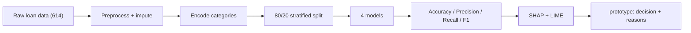

# loan-approval-explainable-ai

Mini Project Assignment  SD:-10.11.26  ED:-25.11.26
FOR Course :- Introduction to Machine Learning  
Course Code:-PCCAIML 502

<div align="center">


**A loan approval classifier**


[Notebook](Loan_Approval%20ai%20.ipynb) · [Results](#model-results) · [Quick start](#quick-start)

</div>

---

## Dashboard at a glance

| Dataset | Algorithms | Best rejection recall | Explainability |
|:---:|:---:|:---:|:---:|
| 614 applicants | 4 models | `0.53` | Tree rules + SHAP + LIME |

---

## Problem

Banks must decide whether to approve a loan. Manual review is slow, and customers and regulators expect a reason for each decision. This project predicts loan approval, compares four classical algorithms, and explains each outcome with SHAP, LIME and interpretable tree rules. It is a mini project, not a complete system workflow for the banking sector.

## Pipeline



## Explainability comparison

| Method | Type | Scope | What it showed |
|---|---|:---:|---|
| Decision tree plot | White-box | whole model | readable if/else rules, depth 4 |
| SHAP (TreeExplainer) | Additive feature attribution | global + single applicant | `Credit_History` dominates (avg impact 0.152 vs 0.028 for the next feature) |
| LIME | Local surrogate | single applicant | agreed with SHAP on the same applicant |

> All 11 features were kept in the final model. A feature-selection comparison (mutual information / RFE / L1) was not part of this run, so the table above compares the three explanation methods instead.

## Model results

| Model | Accuracy | Precision | Recall | F1 | ROC-AUC |
|---|:---:|:---:|:---:|:---:|:---:|
| Logistic Regression | `0.8618` | `0.8400` | `0.9882` | `0.9081` | `0.8019` |
| SVM (RBF) | `0.8537` | `0.8317` | `0.9882` | `0.9032` | `0.7954` |
| Random Forest | `0.8455` | `0.8235` | `0.9882` | `0.8984` | `0.7941` |
| Decision Tree | `0.8455` | `0.8235` | `0.9882` | `0.8984` | `0.7060` |

Evaluated on 123 held-out applicants (80/20 stratified split, `random_state=42`).

> Accuracy alone is misleading here because about 69% of applications are approved. Recall on rejections is the key metric, and it is only **0.53** for every model - the class imbalance makes the models cautious about rejecting. The Random Forest is the model that gets explained, not the one with the best accuracy.

## Why was this applicant rejected?

Each SHAP value is the push that one feature gave to that one decision. Real output for a test applicant:

```text
new application - customer 2
income    : 2500 | loan amount: 250
credit his: 0.0 | area code  : 0

DECISION   : REJECTED        confidence : 68.68 %

Credit_History     = 0.0      -> REJECTION  -0.361
ApplicantIncome    = 2500.0   -> APPROVAL   +0.044
Dependents         = 2.0      -> APPROVAL   +0.032
```

Reasons: no credit history; the application is otherwise fine but credit history alone outweighs everything else.

## Quick start

```bash
git clone https://github.com/le-mort-adhyan/loan-approval-explainable-ai.git
cd loan-approval-explainable-ai
pip install pandas numpy matplotlib seaborn scikit-learn shap lime
jupyter notebook "Loan_Approval ai .ipynb"     # run all cells
```

## Project structure

```text
loan-approval-explainable-ai/
├── .github/workflows
├── 2410.08886v1.pdf
├── LICENSE
├── Loan_Approval ai .ipynb
├── README.md
├── molab.py
├── sample_submission.csv
├── sheikh2020.pdf
├── test.csv
├── test_Y3wMUE5_7gLdaTN.csv
├── train (1).csv
└── train.csv
```

## Dataset

[Loan Prediction Problem Dataset (Kaggle)](https://www.kaggle.com/datasets/altruistdelhite04/loan-prediction-problem-dataset). `train.csv` (614 rows, target `Loan_Status`) and `test.csv` (367 rows) are in the repository root; `test_Y3wMUE5_7gLdaTN.csv` and `train (1).csv` are the original named copies of the same files.

## Limitations

- Small dataset (614 rows), so results vary between runs. A single 80/20 hold-out split is used, so numbers move a little with the seed.
- Class imbalance (69% approved) keeps rejection recall low (0.53). Class weights or SMOTE would be the next step.
- Historical approvals may contain bias. A model trained on them can repeat it.
- This is a student project, not a production credit system.

## Author

**Shankhadip_Karmakar** · Roll no. `35530824067` · GKCIET, Malda, West Bengal · B.Tech CSE (AIML)

---

<div align="center">

If this project helped you, consider starring the repo. Please.

</div>
